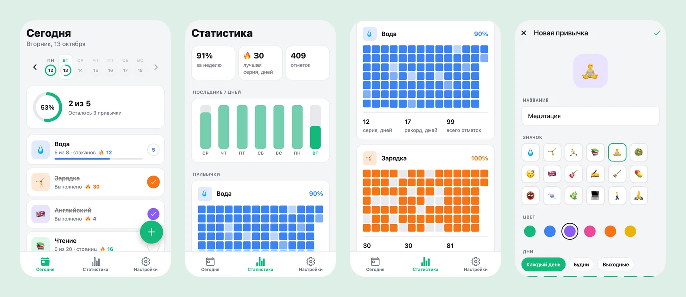
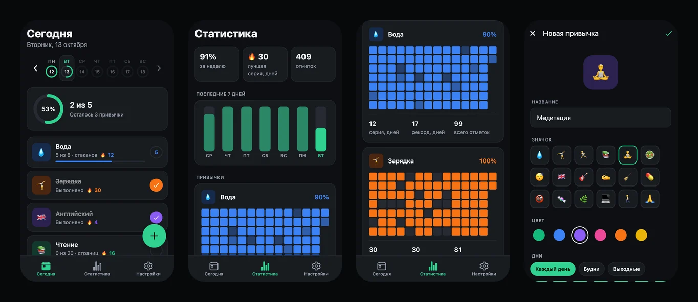

# Ритм — трекер привычек

Мобильное приложение на **React Native + Expo**: один код работает на iOS, Android и в
браузере. Привычки по дням недели, счётчики («8 стаканов воды»), серии, статистика с
«тепловой картой», напоминания. Данные хранятся на устройстве, интернет не нужен.

**Демо в браузере:** https://dmitriy9427.github.io/ritm/ · **Учебник:** [docs/](docs/README.md) — [с чего начать](docs/00-start.md), [разбор кода](docs/code/README.md)

| Светлая тема | Тёмная тема |
| --- | --- |
|  |  |

## Что внутри

- **Три экрана на вкладках и модальная форма** — Expo Router (файловая навигация).
- **Отметка нажатием или свайпом** — Gesture Handler + Reanimated, анимация в UI-потоке.
- **Кольцо прогресса дня** — анимированный SVG.
- **Серии и статистика** — чистые функции с тестами: дни вне расписания серию не рвут,
  незаконченное «сегодня» — тоже.
- **Хранение на устройстве** — Zustand + AsyncStorage, версия данных и ожидание гидрации.
- **Напоминания** — локальные уведомления по дням недели, с запросом разрешения.
- **Вибрация** — три вида тактильного отклика, отключается в настройках.
- **Светлая и тёмная тема**, безопасные зоны, доступность (подписи и роли для скринридеров).

## Запуск

```bash
npm install
npm start
```

- **На телефоне:** установите Expo Go (App Store / Google Play) и отсканируйте QR-код из
  терминала. Телефон и компьютер — в одной сети Wi-Fi. Xcode и Android Studio не нужны.
- **В браузере:** нажмите `w` в терминале или запустите `npm run web`.

Подробно — [docs/02-running.md](docs/02-running.md).

## Команды

| Команда | Что делает |
| --- | --- |
| `npm start` | dev-сервер: QR-код для телефона, `w` — браузер |
| `npm run web` | сразу в браузере |
| `npm run check` | линтер + типы + тесты |
| `npm test` | 30 тестов логики (Jest) |
| `npm run export:web` | веб-сборка в `dist/` |

## Стек

Expo SDK 57 · React Native 0.86 · React 19 · TypeScript · Expo Router · Zustand ·
Reanimated 4 · Gesture Handler · react-native-svg · expo-notifications · expo-haptics · Jest

## Структура

```
src/
├── app/           экраны (файл = экран): вкладки и форма привычки
├── components/    карточка привычки, кольцо, графики, базовые элементы
├── lib/           чистая логика: даты, серии, статистика (+ тесты)
├── store/         состояние и сохранение на устройстве
├── platform/      вибрация, уведомления, диалоги — различия платформ
├── hooks/         тема, «сегодня»
└── constants/     цвета, отступы
docs/              учебник: 9 глав, разбор багов, вопросы к собеседованию
```

## Учебник

Для тех, кто знает React для веба и хочет разобраться в мобильной разработке:
[с чего начать](docs/README.md) · [словарь «веб → React Native»](docs/03-web-to-native.md) ·
[анимации и жесты](docs/07-animations.md) · [найденные баги](docs/lessons.md) ·
[вопросы к собеседованию](docs/interview.md).
