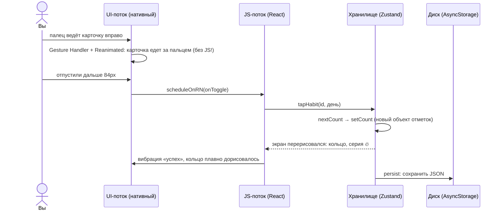

# 00. С чего начать

Этот учебник для человека, который знает React для веба (компоненты, `useState`, `useEffect`),
но ещё не писал мобильных приложений. React Native — тот же React, только вместо `
` —
`<View>`, вместо браузера — телефон.

## Как устроена каждая глава

1. **Зачем** — какую боль решает эта часть, на бытовом примере.
2. **Самый маленький пример** — несколько строк, которые можно понять целиком.
3. **Как это сделано в «Ритме»** — настоящий код с разбором.
4. **Ошибки** — что ломается у всех в первый раз.
5. **Попробуйте сами** — задания с ответами под спойлером.

Лучше всего читать с приложением **в руке**: глава 02 — как за пять минут открыть его на своём
телефоне через Expo Go. Сохранили файл — телефон обновился.

## Картинка целиком: что происходит, когда вы смахиваете привычку

Главная мысль: в React Native **два потока**. JS-поток выполняет React; UI-поток рисует экран.
Если анимировать через `setState`, каждый кадр ходит из JS в UI и обратно — медленно. Поэтому
жест и анимации живут в UI-потоке (Reanimated), а в JS попадает только итог: «отметить».

## Словарь в одну строку

| Слово | Простыми словами | Пример в проекте |
| --- | --- | --- |
| **React Native** | React, который рисует нативные элементы телефона, а не HTML | `<View>`, `<Text>` |
| **Expo** | Набор инструментов вокруг React Native: запуск, модули, сборка | `npx expo start` |
| **Expo Go** | Приложение из магазина, в котором открывается ваш проект без сборки | QR-код в терминале |
| **`View` / `Text`** | `div` и `span`; текст — **только** внутри `Text` | `src/components/ui.tsx` |
| **`StyleSheet`** | Стили объектом, flexbox по умолчанию столбцом | `StyleSheet.create({…})` |
| **`Pressable`** | Всё, на что можно нажать (вместо `onClick` — `onPress`) | карточка привычки |
| **Expo Router** | Навигация из файлов, как в Next.js | `src/app/(tabs)/index.tsx` |
| **Стопка (Stack)** | Экраны друг на друге, «назад» снимает верхний | форма привычки |
| **Безопасные зоны** | Места под вырезом камеры и полоской «домой» | `SafeAreaView` |
| **AsyncStorage** | Хранилище «ключ → строка» на устройстве (как `localStorage`, но асинхронное) | `store.ts` |
| **Гидрация** | Чтение сохранённых данных с диска при запуске | флаг `hydrated` |
| **Миграция** | Приведение старых сохранённых данных к новой форме | `version`, `migrate` |
| **Ключ дня** | Дата строкой `'2026-10-13'` — календарный день, а не момент времени | `DayKey` |
| **UI-поток / JS-поток** | Где рисуется экран / где выполняется React | глава 07 |
| **Shared value** | Число, живущее в UI-потоке, вне рендера React | `useSharedValue(0)` |
| **Ворклет** | Функция, которая выполняется в UI-потоке | обработчики жеста |
| **Тактильный отклик** | Короткая вибрация на действие | `haptic.success()` |
| **Локальное уведомление** | Напоминание, которое планирует само приложение, без сервера | `syncReminders` |
| **EAS Build** | Облачная сборка настоящего приложения для магазинов | глава 09 |

## Как читать код проекта

- **Комментарий в начале каждого файла** — «зачем» и «почему так».
- **Чистая логика** (`src/lib/`) не знает про React и телефон — читается и тестируется отдельно.
- **Всё, что зависит от платформы** (вибрация, уведомления, диалоги), — в `src/platform/`: там
  же написано, что делать в браузере, где этого нет.
- **Не нашли, где что-то делается?** Ищите по тексту на экране: «День закрыт 🎉» →
  `src/app/(tabs)/index.tsx`.

## Порядок чтения

| Если вы хотите… | Читайте |
| --- | --- |
| понять, чем приложение отличается от сайта | [01](01-react-native.md), [02](02-running.md) |
| перевести свои веб-привычки | [03. Словарь «веб → React Native»](03-web-to-native.md) |
| экраны и переходы | [04. Навигация](04-navigation.md) |
| вёрстку, тему, клавиатуру | [05. Интерфейс](05-ui.md) |
| данные и даты | [06. Данные](06-data.md) |
| анимации и жесты | [07](07-animations.md) |
| вибрацию и уведомления | [08](08-native-features.md) |
| понять конкретный файл | [Разбор кода](code/README.md) |

Если времени мало — **03 → 06 → 07** и разбор карточки привычки.
